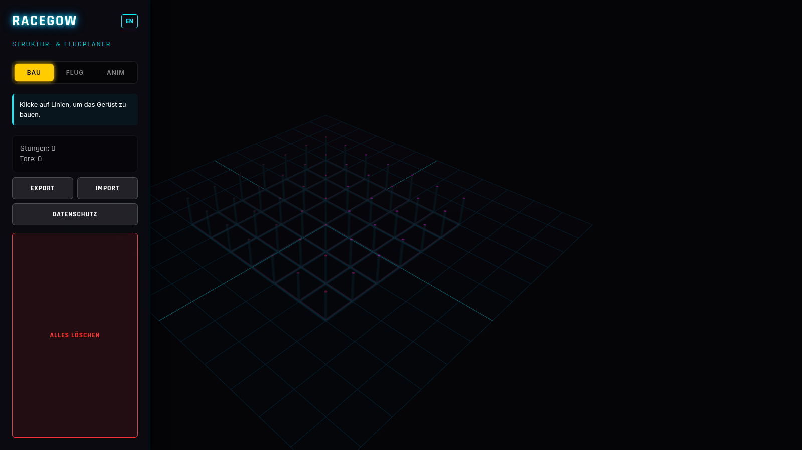

# RaceGOW Planner

A 3D FPV race track planner that runs entirely in the browser. Build a pole
structure on a 3D lattice, mark gates between the poles, then animate a drone
flying the course — and export it as a GIF.

Single-file app: everything lives in `index.html`. No build step, no server-side
code, no tracking.



## Usage

Open `index.html` in a browser, or serve statically (e.g. via GitHub Pages).
The UI is bilingual — default German, click the **EN/DE** button to switch.

### 1. Bau / Build mode

A 7 × 7 × 5 lattice of grid points is shown as faint ghost poles.

- **Left-click** a ghost pole to add it to your structure.
- Only poles adjacent to your existing structure can be selected, starting
  from ground level — so the skeleton always stays connected.
- Click an active (yellow) pole again to remove it.

### 2. Flug / Flight mode

Gate planes appear in every cell of the lattice that is bordered by your poles.

- **Left-click** a gate to add it to the course. Placement order is the flight
  order; the first gate is highlighted green as the **start gate**.
- **Left-click** an active gate again to **invert its flight direction**
  (shown by the white arrow indicator).
- **Right-click** an active gate to remove it.

### 3. Anim / Animation mode

A closed flight path (Catmull-Rom spline) is drawn through all gates, with
approach/exit offsets along each gate's normal direction.

- **Start/Stop** flies a drone model along the course.
- **Speed slider** controls flight speed.
- **Next** jumps the preview to the next gate.
- **GIF** renders 120 frames of the animation and downloads
  `racegow_track.gif` — entirely in your browser.

### Export / Import

- **Export** downloads the track as `racegow_track.json` (poles + gates).
- **Import** loads such a file back.

## Hosting on GitHub Pages

The repo is a static site and needs no workflow:

```bash
gh api repos/<owner>/RaceGowPlanner/pages \
  -F 'source[branch]=main' -F 'source[path]=/' --method POST
```

The site will be live at `https://<owner>.github.io/RaceGowPlanner/` after
about a minute.

## Tech stack

- [Three.js](https://threejs.org/) r128 + OrbitControls (CDN)
- [gif.js](https://github.com/jnordberg/gif.js) for local GIF rendering (CDN)
- Everything else is vanilla JS/CSS in `index.html`

## Privacy

No cookies, no trackers, no server-side storage. See the in-app privacy modal
(datenschutz) for details.

## License

MIT — see [LICENSE](LICENSE).
